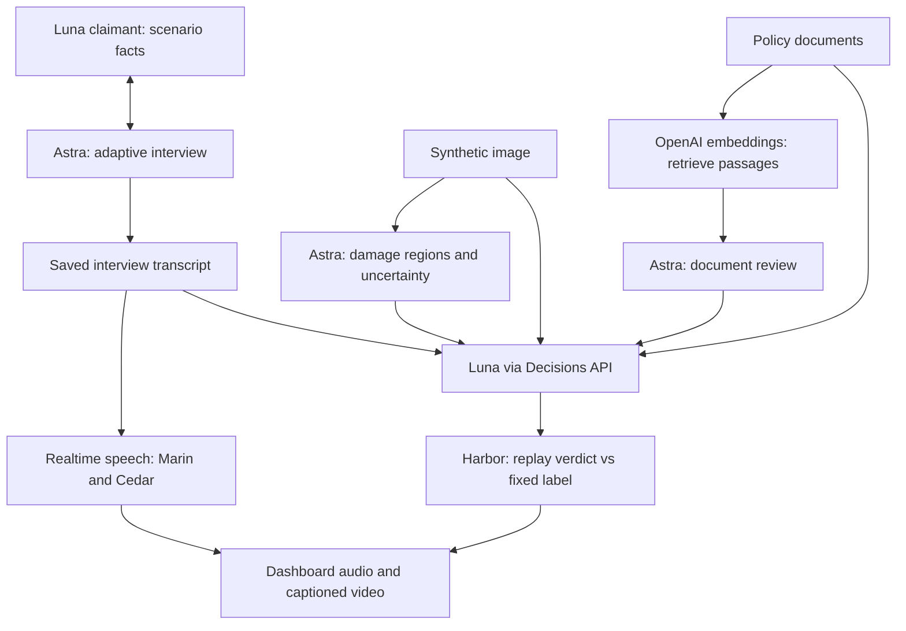

# ClaimLab

**An inspectable, multimodal insurance-claims benchmark—from claimant interview to evidence-grounded coverage classification.**

Built for claims reviewers and AI developers who need to understand why a workflow reaches a decision, what evidence is missing, and where it fails. ClaimLab combines conversations, visual damage observations and policy-document retrieval in a local dashboard with playable AI voices and captioned videos.

**15 synthetic cases · 9 images · 52 voice clips · 15 videos · 3 outcome labels**

The saved demo runs without an API key. Its current Decisions API results match **10/15 expected labels (66.7%)**. This is a small workflow evaluation, not a production accuracy claim.


## Try the saved demo

Requires Python 3.10+ on macOS or Linux. Windows users can use WSL (the process lock uses `fcntl`). No Node build, Docker, OpenAI key or media generation is needed to inspect the saved run.

```sh
git clone https://github.com/mohammed840/claimlab.git
cd claimlab
python3 server.py
```

Open **http://127.0.0.1:8765/**. Select a case to compare expected versus actual decisions, read citations and uncertainty, inspect original images beside Astra's damage overlays, and play the conversation. The **Original run** selector is a historical five-case baseline with different fixtures; do not compare its score directly to the current set.

The repository includes the current media and baseline needed by the dashboard. Avoid **Run conversations** unless you intend to use your own API credentials; the button can generate missing/stale cases and incur charges.

## How it works



| Role | Model / tool | What it does |
| --- | --- | --- |
| Claimant | `gpt-6-luna` | Reports only the fictional scenario facts; answers follow-ups without inventing details. |
| Interview and explanations | `gpt-6-astra` | Asks up to two adaptive follow-ups and records its own assessment, evidence and uncertainty. |
| Vision | `gpt-6-astra` | Locates visible damage in nine synthetic images. Boxes and limitations feed Decisions before classification. |
| Document retrieval | `text-embedding-3-small` | Retrieves eight policy passages for each of six text-only cases; Astra reviews the retrieved material. |
| **Main model under evaluation** | **`gpt-6-luna` through `/v1/decisions`** | Chooses `covered`, `excluded` or `needs_review` using the collected evidence. |
| Images | `gpt-image-2` | Generates fictional evidence illustrations. |
| Speech | `gpt-realtime-2.1-mini` | Reads the saved dialogue with Marin as claimant and Cedar as adjuster. Returned speech transcripts are checked against the script. |
| Evaluation | Harbor | Replays saved Decisions verdicts in containers and checks fixed expected labels. No fresh model inference. |

Decisions receives the interview, fictional declarations, policy evidence and available image/visual findings. For text-only cases, retrieved passages and Astra's document review replace the preselected policy excerpts. Expected labels, private claimant facts and Astra's final coverage verdict are excluded from the Decisions input. Astra's separate verdict is shown for comparison; it is not the benchmarked decision. Vocal tone is not coverage evidence.

## Run the evaluations

### Fast saved-result check—no keys, Docker or network

```sh
python3 eval_harbor.py --score-only
python3 -m unittest -v test_pipeline.py
```

The score command verifies that saved decisions match their source evidence, prints each expected/actual label and reports **10/15 (66.7%)**. A label mismatch is an evaluation result, not a process failure. Invalid or stale evidence exits nonzero. This command is a local score check, not a Harbor execution.

### Full Harbor container replay

Install [uv](https://docs.astral.sh/uv/getting-started/installation/) and start Docker, then:

```sh
uv tool install harbor==0.3.0
python3 eval_harbor.py --build-only
python3 eval_harbor.py
```

Harbor 0.3.0 was used for the recorded run. The exporter creates one task per case under `harbor_tasks/`. Harbor's Oracle submits the saved model verdict; the verifier compares it with the fixed expected label. Logs go to `jobs/`, and the dashboard summary is updated in `public/data/harbor-summary.json`. The replay measures label agreement only, not reasoning quality, confidence calibration, visual localization or speech realism.

## Current results

| Subset | Cases | Correct labels | Accuracy |
| --- | ---: | ---: | ---: |
| All cases | 15 | 10 | 66.7% |
| Image cases | 9 | 8 | 88.9% |
| Document retrieval cases | 6 | 2 | 33.3% |

Harbor completed 15 trials with zero execution errors. All six document cases returned `needs_review`. Failures include flood coverage, animal avoidance, intentional owner damage and both business-use cases. See [the per-case results and limitations](docs/RESULTS.md).

The expected-label distribution is 5 covered, 4 excluded and 6 requiring review; the majority-label baseline is 40%. The document workflow is a functioning retrieval demonstration, **not a demonstrated accuracy improvement**. Missing retrieved terms and incomplete interviews can affect outcomes. The model's choice response does not establish why it abstained.

## Data and examples

- [Dataset card and provenance](docs/DATASET.md): source policies, synthetic data, labels and limitations.
- [Three representative cases](examples/cases.json): one auto-image, one property-image and one document case, extracted from the active fixtures.
- [All 15 fixtures](scenarios.json): private claimant facts, selected policy terms and frozen expected labels.
- [Saved conversations and evidence](public/data/results.json), [Decisions outputs](public/data/decisions.json), [Harbor summary](public/data/harbor-summary.json).
- [Project name and description](PROJECT_DESCRIPTION.md).
- [Codex contribution and benchmarking submission](CODEX_BENCHMARK_SUBMISSION.md).

Current media totals about **55 MiB** (largest file under 2 MiB). Including the historical baseline brings media to about **69 MiB**. This fits ordinary GitHub storage without Git LFS; Hugging Face is unnecessary for this release. Regeneration archives, credentials, embedding caches and full policy-source extractions are excluded. See [GitHub's size guidance](https://docs.github.com/en/repositories/working-with-files/managing-large-files/about-large-files-on-github).

## Generate new outputs—optional, paid

You need access to the exact configured OpenAI models and Decisions API. Availability is account-dependent; these identifiers are not silently replaced with different models. Install `ffmpeg` and `ffprobe` using your system package manager for video assembly.

```sh
python3 -m venv .venv
source .venv/bin/activate
python -m pip install -r requirements.txt
cp .env.example .env
# Set OPENAI_API_KEY in .env locally; never commit it.
python pipeline.py
python decisions_compare.py
python eval_harbor.py
```

The pipeline reuses valid saved records. To create a fresh run, first back up and move `public/data/results.json`, `public/data/decisions.json` and generated media out of their active paths. Keep `scenarios.json` and expected labels unchanged when comparing runs. New model outputs are stochastic; saved scores are reproducible by replay, not guaranteed by fresh inference.

**Before fresh document retrieval:** create the excluded `policy_corpus.json` from the two policy PDFs linked in the dataset card. The original run used Exa PDF text extraction. Required JSON structure:

```json
[
  {"id":"ca-auto","url":"https://nationalgeneral.com/forms_catalog/CAIP400_03012006_CA.pdf","text":"<full extracted text>","note":"Historical 2006 sample"},
  {"id":"ca-renters","url":"https://www.goodcover.com/files/sample-policies/california/policy-sample.pdf","text":"<full extracted text>","note":"Software-testing sample, not an issued policy"}
]
```

Use full extracted document text, not the placeholder strings. Extraction changes can change retrieval and scores. `policy_rag.py` chunks at 3,000 characters with 500-character overlap and uses a local embedding index. The original full-text corpus and cache are not distributed; the recorded retrieved passages are included for inspection and saved-result replay. Fresh document inference therefore requires this preparation step.

To refresh only the existing voices and videos:

```sh
python refresh_voices.py
```

This requires all 15 saved cases, stages the refresh, and switches the dashboard only after every case completes. Prior media is retained locally. Speech generation can paraphrase; mismatched clips are rejected rather than changing the claim transcript. The voices are prerecorded AI narration, not a live phone session.

## Built today—November 1, 2026

- Built the Python pipeline and local dashboard for a claimant/adjuster interview, cited assessment, images, audio and captioned videos.
- Expanded from five car-focused tasks to 15 tricky auto/property scenarios, including four non-car image cases.
- Added Astra damage localization before Decisions and side-by-side original/overlay inspection.
- Added OpenAI embedding retrieval and Astra document reviews for six non-image cases.
- Made Luna Decisions verdicts the explicit benchmark target and added Harbor saved-output replay.
- Migrated all 52 voice clips and 15 videos to `gpt-realtime-2.1-mini`, with exact-script checks and preservation of previous media.
- Prepared this reproducible saved demo, per-case results, sample fixtures and evaluation commands.

**Concrete Codex contribution:** Codex implemented the Realtime WebSocket migration and staged voice-refresh command, added focused protocol checks, then used the authorized API run to generate the media. Wording validation rejected a paraphrased camera-theft sentence; the clip was regenerated without altering the evidence or benchmark outcomes.
