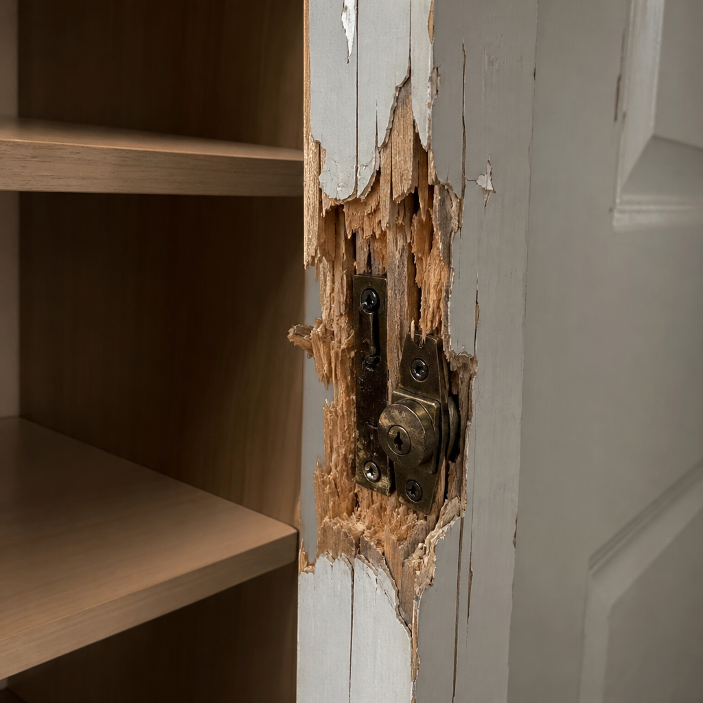

# A broken lock. A missing camera. Is the claim covered?

A picture shows damage—but it cannot tell you whether a police report was filed. Follow this complete six-turn conversation as the claimant reports the loss and Astra asks what it still needs to know.

**[▶ Open the full recorded conversation](../public/media/property-forced-entry-report-unknown/v4-realtime/conversation.mp4)** · 60 seconds · AI voices and captioned video

If GitHub does not preview the video, use **View raw** or download it to play locally.

## Full conversation

This is the actual saved demo transcript, with no extra dialogue added. The claimant uses Luna; the adjuster uses Astra. Speech is generated by `gpt-realtime-2.1-mini`: Marin for the claimant and Cedar for the adjuster. The scenario and image are synthetic.

### 1. Claimant

Hi, I came home and found the door lock splintered and my camera missing from its usual shelf. The door frame is splintered around the lock, and the shelf is empty.

[Listen to this turn](../public/media/property-forced-entry-report-unknown/v4-realtime/turn_1_a4ed59edb0d5.wav)

### 2. Adjuster

I’m sorry to hear that. Have you filed a police report about the missing camera and damaged lock?

[Listen to this turn](../public/media/property-forced-entry-report-unknown/v4-realtime/turn_2_5068c66eb3e9.wav)

### 3. Claimant

I haven’t filed one myself. My housemate said they’d contact the police, but I don’t know whether a report was filed.

[Listen to this turn](../public/media/property-forced-entry-report-unknown/v4-realtime/turn_3_560f7f402c71.wav)

### 4. Adjuster

Thanks for explaining. Was the damage around the lock new when you found the camera missing, or was it already there?

[Listen to this turn](../public/media/property-forced-entry-report-unknown/v4-realtime/turn_4_d97b5f36be31.wav)

### 5. Claimant

It was new when I found the camera missing.

[Listen to this turn](../public/media/property-forced-entry-report-unknown/v4-realtime/turn_5_7379f7cdf342.wav)

### 6. Adjuster

Decision: requires further review. The claimant reports a missing camera and newly splintered wood around the door lock, with visible damage corroborated by the image, supporting the forced-entry damage requirement of CA-HO4-FORCE. The required police report remains unconfirmed because the claimant does not know whether their housemate filed one. Next action: Confirm whether the housemate filed a police report and obtain it; if none exists, request that the claimant file one before reassessment.

[Listen to this turn](../public/media/property-forced-entry-report-unknown/v4-realtime/turn_6_fc3c4d1b3336.wav)

## What the benchmark evaluates

Astra’s spoken assessment is separate from the benchmarked Decisions API output. For this case, Luna’s Decisions API receives the interview, policy evidence, original image and Astra’s visual findings, excluding Astra’s final verdict and the expected label.

| Result | Outcome |
| --- | --- |
| Fixed expected label | Requires further review |
| Luna Decisions API | Requires further review |
| Astra’s separate assessment | Requires further review |
| Harbor saved-verdict reward | 1 / 1 |

The missing police-report confirmation is the key unresolved fact under the supplied demo terms. This single match is an example, not the aggregate result: the full benchmark matches **10 of 15** expected labels. See [all results](RESULTS.md) and [the dataset limitations](DATASET.md).

[Back to ClaimLab](../README.md)
